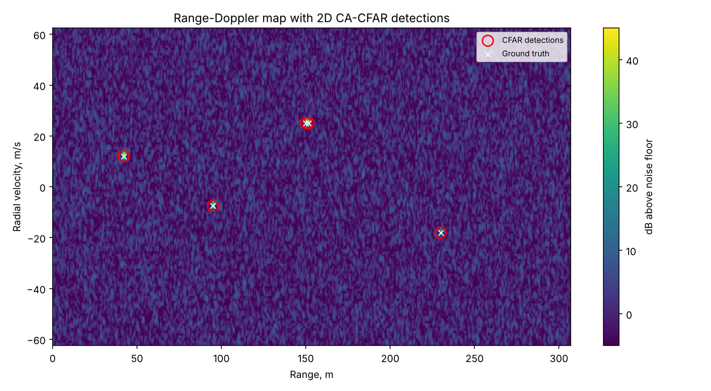
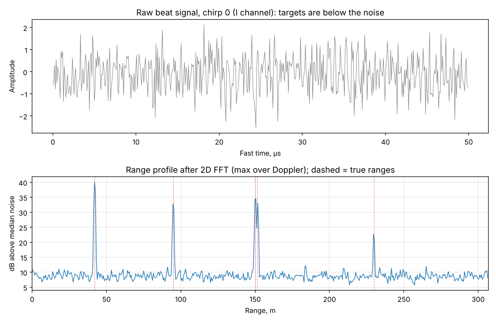
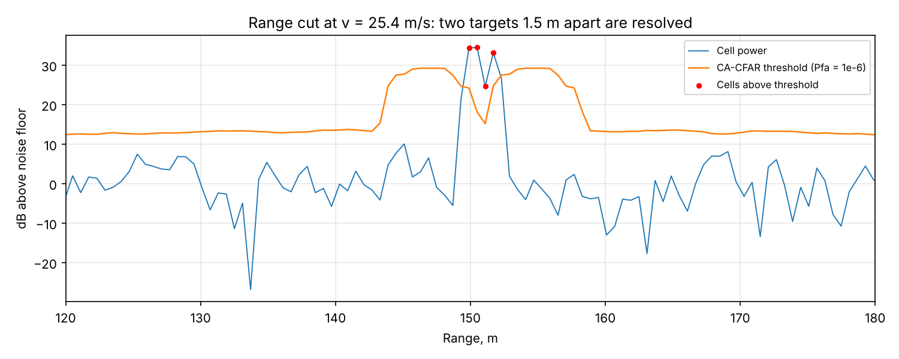
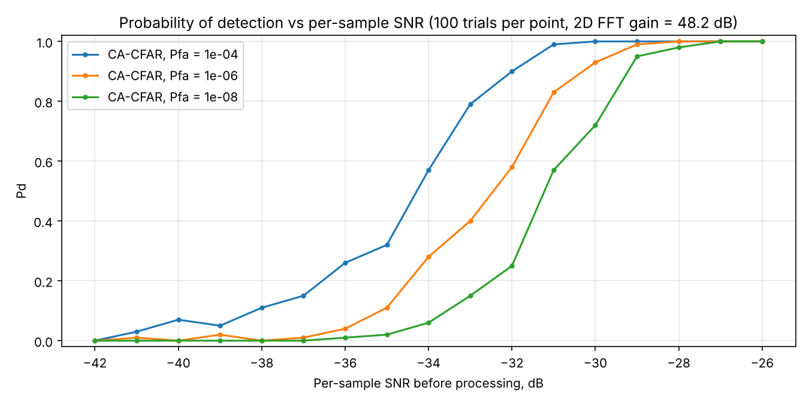

# FMCW Radar Signal Processing Pipeline

End-to-end FMCW radar processing in Python: physically modelled beat-signal simulation, windowed range-Doppler processing, 2D CA-CFAR detection, peak extraction with sub-bin interpolation and range-Doppler coupling correction — verified by unit tests and a Monte Carlo detection study.



## What it does

| Stage | Implementation |
|---|---|
| Signal model | Exact dechirped mixer output `tx · conj(rx)` for a sawtooth chirp, with range migration within and across chirps, complex (IQ) sampling, AWGN |
| Range processing | Hann-windowed FFT over fast time |
| Doppler processing | Hann-windowed FFT over slow time, zero velocity centred |
| Detection | 2D cell-averaging CFAR (guard/training windows, Doppler axis wraps, range axis mirrored at edges) |
| Peak extraction | Local-maximum selection so adjacent targets are not merged, parabolic sub-bin interpolation in range and Doppler |
| Correction | Range-Doppler coupling bias removed (`ΔR = v·fc / slope`, up to 0.2 m at 44 m/s) |

## Results

Default sensor: 24 GHz, 250 MHz sweep, 128 chirps × 512 samples → **0.60 m** range resolution (307 m max), **0.98 m/s** velocity resolution (±62.5 m/s).

Five targets, all **below the noise floor** in the raw samples (−5 to −22 dB per-sample SNR), including two targets only 1.5 m apart at the same speed:

| True range, m | True velocity, m/s | Raw SNR | Est. range, m | Est. velocity, m/s | Range error | Velocity error |
|---:|---:|---:|---:|---:|---:|---:|
| 42.00 | 12.00 | −5 dB | 42.05 | 12.08 | 0.05 | 0.08 |
| 95.00 | −7.50 | −12 dB | 94.98 | −7.50 | −0.02 | 0.00 |
| 150.00 | 25.00 | −10 dB | 150.08 | 25.12 | 0.08 | 0.12 |
| 151.50 | 25.00 | −13 dB | 151.62 | 25.11 | 0.12 | 0.11 |
| 230.00 | −18.00 | −22 dB | 229.93 | −18.04 | −0.07 | −0.04 |

5 detections, 0 false alarms. Over 200 random single targets the RMS error is **0.11 m in range** (18 % of a resolution cell) and **0.16 m/s in velocity**.

The 2D FFT gives 48.2 dB of coherent gain, so a target at −22 dB per sample ends up ~21 dB above the local noise estimate:



The close pair is resolved because peaks are taken as local maxima rather than connected clusters — a naive connected-component clustering merges them into one detection:



### Detection performance (Monte Carlo)

100 trials per SNR point, random range and velocity:



With Pfa = 10⁻⁶ the pipeline reaches Pd ≈ 0.9 at −30 dB per-sample SNR. The measured false-alarm rate is about 2× the cell-level design value (0.16 vs 0.07 per frame): the windows correlate neighbouring cells, which reduces the effective number of independent training cells. This is expected behaviour, and it is documented rather than hidden.

## Run it

```bash
pip install -r requirements.txt
python run_demo.py        # scenario above, figures to docs/
python monte_carlo.py     # Pd vs SNR study (~30 s)
pytest -q                 # 8 tests
```

## Code layout

```
radar/
  config.py       radar parameters and derived quantities (resolution, max range/velocity)
  simulate.py     beat-signal generator
  processing.py   range-Doppler map, axes, peak extraction and correction
  cfar.py         2D CA-CFAR
run_demo.py       end-to-end scenario and plots
monte_carlo.py    detection-probability study
tests/            accuracy, resolution, false-alarm and sensitivity tests
```

## Possible extensions

- OS-CFAR for better behaviour in multi-target and clutter-edge conditions
- Multi-channel receive and angle-of-arrival estimation (FFT / MUSIC)
- Tracking layer (alpha-beta or Kalman) over successive frames
- Fixed-point port of the pipeline for an MCU/DSP target

## License

MIT
